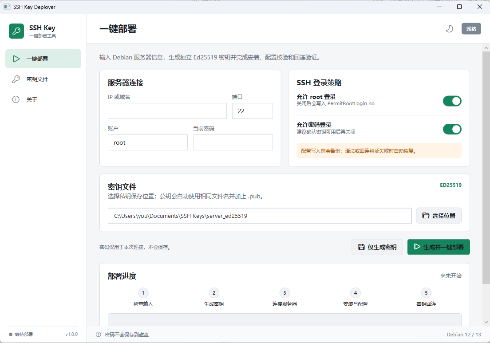

# SSH Key Deployer

[](https://github.com/tuolaji996/windows-ssh-key-deployer/actions/workflows/ci.yml)
[](LICENSE)
[](https://github.com/tuolaji996/windows-ssh-key-deployer/releases/latest)

[English](#english) | [简体中文](#简体中文)

<p align="center">
  
</p>
<p align="center">
  <sub>Current Simplified Chinese interface / 当前简体中文界面. The example private-key path is anonymized / 示例私钥路径已脱敏。</sub>
</p>

## English

SSH Key Deployer is a Windows and macOS desktop application for creating an independent Ed25519 SSH key pair and deploying it to Linux servers you own or are authorized to administer. It is designed for the common first-login workflow: connect with an account and password, install the public key, choose SSH login policies, validate the server configuration, and confirm that key login works.

Two macOS builds are available:

| | Native app (SwiftUI, recommended) | Cross-platform app (.NET / Avalonia) |
| --- | --- | --- |
| Source | [`macos-native/`](macos-native) | [`src/SshKeyDeployer.Mac/`](src/SshKeyDeployer.Mac) |
| Macs | Apple Silicon and Intel (universal binary) | Apple Silicon only |
| macOS | 13 Ventura or later | 12 Monterey or later |
| Runtime | None needed (system frameworks only) | Bundles the .NET runtime |
| SSH | macOS built-in `/usr/bin/ssh`, `ssh-keyscan`, `ssh-keygen` | SSH.NET library |

### Features

- Generates separate Ed25519 private and public key files; Windows stores new keys under `%USERPROFILE%\.ssh\ssh-key-deployer` by default and restricts the private-key ACL, while macOS restricts it to owner read/write (`0600`).
- Rejects Windows UNC paths and mapped network drives for private keys because Windows OpenSSH cannot reliably enforce its required local ACL there.
- Requests explicit approval of the SSH host-key fingerprint on first contact or when it changes.
- Installs the public key in `authorized_keys` and can enable or disable root login and password authentication.
- Backs up affected SSH settings, checks `sshd` syntax and effective configuration, reloads SSH, and verifies a new key-based login. It attempts rollback when a deployment step fails.
- Inspects the server before changing anything: it checks the account's privileges first (root, sudo, or `su` with the root password), then the distribution, package manager, init system, firewall and SELinux, and shows a plan you must approve.
- If the account has no sudo, it can use `su` with the root password to install `sudo` with the server's package manager (after you approve) and grant a temporary sudo rule that is always removed afterwards.
- Can move SSH to a new port in two phases: the new port is opened (ufw/firewalld, SELinux label) and key login is verified on it before the old port is closed; any failure rolls back.
- Keeps the password in memory only for the current connection; it is not written to configuration files or logs.
- Includes Simplified Chinese and English UI switching, light and dark themes, and a local key-file view.
- The native macOS app adds a deployment step list, copy-public-key and Show in Finder actions, file pickers for new or existing keys, and a safe quit: quitting during a deployment cancels it and waits for rollback before exiting.

### Requirements

- Windows 10 or Windows 11, x64; macOS 13+ on Apple Silicon or Intel for the native app; or macOS 12+ on Apple Silicon for the cross-platform app.
- Windows OpenSSH Client, including `ssh-keygen.exe`; macOS uses the system OpenSSH tools in `/usr/bin`, which ship with every Mac.
- A Linux server running OpenSSH Server whose `/etc/ssh/sshd_config` includes `/etc/ssh/sshd_config.d/*.conf`. Tested in CI on Debian 12/13, Ubuntu 22.04/24.04, AlmaLinux 9, Fedora, openSUSE Leap 15.6, Arch Linux and Alpine. RHEL/Rocky 9 work like AlmaLinux; CentOS/RHEL 7–8 and Amazon Linux 2 lack the include line and are stopped before any change, with instructions.
- An initial SSH account and password, plus root, `sudo`, or the root password (for `su`).

### Install on Windows

Download the `win-x64` ZIP and matching `.sha256` file from [Releases](https://github.com/tuolaji996/windows-ssh-key-deployer/releases/latest). Verify the checksum before extracting and running `SshKeyDeployer.exe`:

```powershell
Get-FileHash .\SSH-Key-Deployer-*-win-x64.zip -Algorithm SHA256
```

You can also install a selected release using the repository script:

```powershell
powershell.exe -NoProfile -ExecutionPolicy Bypass -File .\install.ps1 -Version 1.4.0
```

By default, the application is installed under `%LOCALAPPDATA%\Programs\SSH Key Deployer` and does not require administrator privileges.

### Install the native macOS app

Download the `macos-universal` ZIP and matching `.sha256` file from [Releases](https://github.com/tuolaji996/windows-ssh-key-deployer/releases/latest), then verify and open the app:

```bash
shasum -a 256 -c SSH-Key-Deployer-*-macos-universal.zip.sha256
ditto -x -k SSH-Key-Deployer-*-macos-universal.zip .
open "SSH Key Deployer.app"
```

The app is ad-hoc signed but not notarized, so on first launch macOS asks for confirmation (Control-click the app and choose **Open**, or allow it in **System Settings → Privacy & Security**). Only do that after the checksum matches and you trust this project. You can also move the app into `/Applications`.

#### How the native app connects

- It reads the server's host key with `ssh-keyscan` and shows the SHA-256 and MD5 fingerprints. Nothing is sent to the server until you approve.
- The approved key is pinned in a private, temporary `known_hosts` file, and every later connection uses `StrictHostKeyChecking=yes` against that single key. Your own `~/.ssh/config`, `~/.ssh/known_hosts` and SSH agent are never read or changed.
- The password authenticates one OpenSSH ControlMaster connection, so it is sent to the server once; all other commands run over that connection. The password reaches `ssh` through an `SSH_ASKPASS` helper environment variable visible only to your macOS account and root, and is never written to disk. sudo receives it on standard input, never on a command line.
- Key-login verification opens a separate connection that may only use the new private key.

### Install the cross-platform app on macOS Apple Silicon

Download the `osx-arm64` ZIP and matching `.sha256` file from [Releases](https://github.com/tuolaji996/windows-ssh-key-deployer/releases/latest), then verify and open the app:

```bash
shasum -a 256 SSH-Key-Deployer-*-osx-arm64.zip
unzip SSH-Key-Deployer-*-osx-arm64.zip
open "SSH Key Deployer.app"
```

The current macOS package is an unsigned technical preview because no Apple Developer signing/notarization credential is stored in this project. Gatekeeper may require an explicit confirmation in **System Settings → Privacy & Security**. Only do that after the SHA-256 matches the released sidecar file and you trust this project.

### Deploy a key

1. Enter the server host name or IP address, SSH port, account name, and current password.
2. Choose a local-disk location for the new private key, then select the desired root-login and password-authentication policies. On Windows, do not use a UNC path or mapped network drive.
3. Compare the displayed host-key fingerprint through an independent channel, such as the provider console, before approving it.
4. Review the plan: the detected system, how root access is obtained, and every change, including persistent ones such as package installs. Nothing on the server changes until you approve it.
5. Start deployment and wait until the key-login verification succeeds. Keep your existing server console or SSH session open until that check completes.

Use this application only for servers you own or have explicit permission to manage. Cancel the deployment if a host fingerprint is unexpected or does not match your independent verification.

### Troubleshooting

#### The account is not in the sudoers file

Successfully running `su` with the root password does not give the logged-in account `sudo` permission. From a root console, run the following commands, replacing `your-user` with the deployment account:

```bash
su -
apt-get update
apt-get install -y sudo
adduser your-user sudo
exit
```

On other distributions use the matching commands: Fedora/RHEL/Rocky/Alma `dnf install -y sudo && usermod -aG wheel your-user`; openSUSE `zypper install sudo && usermod -aG wheel your-user`; Arch `pacman -S sudo`, `usermod -aG wheel your-user`, then enable the `%wheel` line with `visudo`; Alpine `apk add sudo && adduser your-user wheel`. Alternatively, enter the root password in the app ("If this account has no sudo") and it will do this through `su` for the deployment only.

If `sudo` is already installed, the two `apt-get` commands can be skipped. Fully sign out of every session for that account, sign in again, run `sudo -k true` with the account's own password, and retry the deployment.

#### The server does not load `/etc/ssh/sshd_config.d`

The app writes its SSH policy to `/etc/ssh/sshd_config.d/00-ssh-key-deployer.conf` and never edits the main `sshd_config`. Older systems (CentOS/RHEL 7–8, Amazon Linux 2) do not read that folder, so the app stops before making any change. Add this line near the top of `/etc/ssh/sshd_config`, run `sshd -t`, reload SSH and retry:

```text
Include /etc/ssh/sshd_config.d/*.conf
```

#### Windows OpenSSH rejects a private key on `Z:` or another network drive

Keep the private key and its matching `.pub` file on a local Windows drive, preferably under `%USERPROFILE%\.ssh`. The app now blocks UNC and mapped-drive locations before generating or deploying a key and explains how to correct the path.

For a Codex remote connection, use a concrete alias in `%USERPROFILE%\.ssh\config` and point `IdentityFile` to the local key:

```text
Host debian-home
  HostName 192.0.2.10
  User your-user
  IdentityFile C:/Users/your-name/.ssh/ssh-key-deployer/server_ed25519
```

Independently verify the server fingerprint, confirm `ssh debian-home` works from the same Windows machine, and only then enable the host in Codex. Do not bypass host-key checking. See the official [Codex remote connections guide](https://learn.chatgpt.com/docs/remote-connections).

### Build from source

Install the .NET 8 SDK. On Windows, use Windows PowerShell 5.1 or PowerShell 7:

```powershell
.\build.ps1
.\scripts\scan-secrets.ps1
```

Create a self-contained, single-file `win-x64` package with:

```powershell
.\release.ps1 -Version 1.4.0
```

The ZIP archive and checksum are written to `artifacts/`.

On macOS, build the native universal app with Xcode 15 or later (or the Command Line Tools). The script runs the unit tests first:

```bash
./macos-native/package.sh 1.4.0
```

During development you can run it directly with `swift run --package-path macos-native`, and run the tests with `swift test --package-path macos-native`.

Build the cross-platform, self-contained Apple Silicon `.app` package with:

```bash
./scripts/package-macos.sh 1.4.0
```

Both macOS ZIP files and their checksums are written to `artifacts/`.

### Security and license

Report security concerns privately according to [SECURITY.md](SECURITY.md). This project is released under the [MIT License](LICENSE).

---

## 简体中文

SSH Key Deployer 是一款支持 Windows 和 macOS 的桌面工具，用于生成独立的 Ed25519 SSH 密钥对，并部署到你拥有或获得明确授权管理的 Linux 服务器。它覆盖常见的首次登录流程：使用账户和密码连接、安装公钥、选择 SSH 登录策略、检查服务器配置，并验证密钥登录是否成功。

macOS 提供两个版本：

| | 原生版（SwiftUI，推荐） | 跨平台版（.NET / Avalonia） |
| --- | --- | --- |
| 源码 | [`macos-native/`](macos-native) | [`src/SshKeyDeployer.Mac/`](src/SshKeyDeployer.Mac) |
| 适用 Mac | Apple Silicon 与 Intel（通用二进制） | 仅 Apple Silicon |
| 系统 | macOS 13 Ventura 及以上 | macOS 12 Monterey 及以上 |
| 运行时 | 无需额外运行时（仅用系统框架） | 内置 .NET 运行时 |
| SSH 实现 | 系统自带的 `/usr/bin/ssh`、`ssh-keyscan`、`ssh-keygen` | SSH.NET 库 |

### 主要功能

- 在本机生成独立的 Ed25519 私钥和公钥文件；Windows 默认保存到 `%USERPROFILE%\.ssh\ssh-key-deployer` 并收紧私钥 ACL，macOS 会将私钥限制为仅当前用户可读写（`0600`）。
- Windows 下会拒绝把私钥保存到 UNC 网络路径或映射盘，因为 Windows OpenSSH 无法在那里可靠实施所需的本机 ACL。
- 首次连接或主机密钥发生变化时，要求用户明确核对和确认 SSH 主机指纹。
- 将公钥安装到 `authorized_keys`，并可选择开启或关闭 root 登录和密码登录。
- 备份受影响的 SSH 设置，检查 `sshd` 语法和有效配置，重载 SSH，并验证新密钥能够登录；部署步骤失败时会尝试回滚。
- 修改前先检测服务器：先检查账户权限（root、sudo，或用 root 密码通过 `su`），再检测发行版、包管理器、init 系统、防火墙和 SELinux，并列出变更计划，需你确认后才执行。
- 账户没有 sudo 时，可用 root 密码通过 `su` 调用服务器的包管理器安装 `sudo`（需确认），并授予临时 sudo 规则，结束后一定删除。
- 可分两阶段修改 SSH 端口：先放行新端口（ufw/firewalld、SELinux 标签）并在新端口验证密钥登录，再关闭旧端口；任何一步失败都会回滚。
- 密码只用于当前连接，既不会写入配置，也不会记录到日志。
- 支持简体中文和英文界面切换，并提供亮色、深色主题和本机密钥文件查看入口。
- 原生 macOS 版额外提供部署步骤列表、复制公钥、在访达中显示、选择新建或现有密钥的文件面板，以及安全退出：部署中退出会先取消并等待回滚完成后再关闭。

### 系统要求

- Windows 10 或 Windows 11，x64；原生版需要 macOS 13+（Apple Silicon 或 Intel）；跨平台版需要 Apple Silicon 上的 macOS 12+。
- Windows 需要安装 Windows OpenSSH Client（含 `ssh-keygen.exe`）；macOS 使用每台 Mac 都自带的 `/usr/bin` 下的 OpenSSH 工具。
- 目标为运行 OpenSSH Server 的 Linux 服务器，且 `/etc/ssh/sshd_config` 包含 `/etc/ssh/sshd_config.d/*.conf`。CI 中已在 Debian 12/13、Ubuntu 22.04/24.04、AlmaLinux 9、Fedora、openSUSE Leap 15.6、Arch Linux 和 Alpine 上实测；RHEL/Rocky 9 与 AlmaLinux 相同；CentOS/RHEL 7–8、Amazon Linux 2 缺少该 Include 行，会在任何修改前停止并给出处理步骤。
- 首次连接所需的账户和密码，以及 root、`sudo` 或 root 密码（用于 `su`）之一。

### Windows 安装

从 [Releases](https://github.com/tuolaji996/windows-ssh-key-deployer/releases/latest) 下载 `win-x64` ZIP 压缩包及对应的 `.sha256` 文件。核对哈希后，解压并运行 `SshKeyDeployer.exe`：

```powershell
Get-FileHash .\SSH-Key-Deployer-*-win-x64.zip -Algorithm SHA256
```

也可以使用仓库中的脚本安装指定版本：

```powershell
powershell.exe -NoProfile -ExecutionPolicy Bypass -File .\install.ps1 -Version 1.4.0
```

默认会安装到当前用户的 `%LOCALAPPDATA%\Programs\SSH Key Deployer`，不需要管理员权限。

### 安装原生 macOS 版

从 [Releases](https://github.com/tuolaji996/windows-ssh-key-deployer/releases/latest) 下载 `macos-universal` ZIP 压缩包及对应的 `.sha256` 文件，核对哈希后解压并打开：

```bash
shasum -a 256 -c SSH-Key-Deployer-*-macos-universal.zip.sha256
ditto -x -k SSH-Key-Deployer-*-macos-universal.zip .
open "SSH Key Deployer.app"
```

应用使用临时（ad-hoc）签名但未经公证，首次打开时 macOS 会要求确认（按住 Control 点按应用并选择 **打开**，或在 **系统设置 → 隐私与安全性** 中允许）。只有在哈希一致且你信任本项目时才这样做。也可以把应用移到 `/Applications`。

#### 原生版如何连接服务器

- 先用 `ssh-keyscan` 读取服务器主机密钥并显示 SHA-256 与 MD5 指纹；在你确认之前，不会向服务器发送任何凭据。
- 确认后的主机密钥固定写入一个私有的临时 `known_hosts`，之后每次连接都以 `StrictHostKeyChecking=yes` 只信任这一个密钥。不会读取或修改你自己的 `~/.ssh/config`、`~/.ssh/known_hosts` 和 SSH agent。
- 密码只用于建立一条 OpenSSH ControlMaster 连接，因此只向服务器发送一次，其余命令都复用这条连接。密码通过 `SSH_ASKPASS` 辅助程序的环境变量交给 `ssh`，只有你的 macOS 账户和 root 能看到，绝不写入磁盘；sudo 通过标准输入接收密码，不会出现在命令行中。
- 密钥登录验证会另开一条只能使用新私钥的连接。

### 在 Apple Silicon Mac 上安装跨平台版

从 [Releases](https://github.com/tuolaji996/windows-ssh-key-deployer/releases/latest) 下载 `osx-arm64` ZIP 压缩包及对应的 `.sha256` 文件，核对哈希后解压并打开：

```bash
shasum -a 256 SSH-Key-Deployer-*-osx-arm64.zip
unzip SSH-Key-Deployer-*-osx-arm64.zip
open "SSH Key Deployer.app"
```

当前 macOS 包是未签名的技术预览版：仓库中没有保存 Apple Developer 签名或公证凭据。Gatekeeper 可能要求你在 **系统设置 → 隐私与安全性** 中明确确认。只有在 SHA-256 与发布页的同名校验文件一致，并且你确认信任该项目时才这样做。

### 部署密钥

1. 填写服务器域名或 IP、SSH 端口、账户和当前密码。
2. 选择新私钥在本机磁盘上的保存位置，并设定 root 登录和密码登录策略。Windows 下不要使用 UNC 网络路径或映射盘。
3. 通过独立渠道核对显示的主机指纹，例如云服务商控制台，确认无误后再继续。
4. 查看变更计划：检测到的系统、获取 root 权限的方式和每一项变更（包括安装软件包这类不会回滚的变更）。确认之前服务器不会有任何改动。
5. 启动部署，等待密钥回连验证成功。在验证完成前，请保留现有服务器控制台或 SSH 会话。

本工具仅可用于你拥有或获得明确授权的服务器。遇到意外的主机指纹或无法独立核对的指纹时，请取消部署。

### 常见问题排查

#### 提示账户不在 sudoers 文件中

能够用 root 密码执行 `su`，只说明你知道 root 密码，并不代表当前登录账户拥有 `sudo` 权限。请在 root 终端执行下面的命令，把 `your-user` 换成部署账户：

```bash
su -
apt-get update
apt-get install -y sudo
adduser your-user sudo
exit
```

其他发行版请用对应命令：Fedora/RHEL/Rocky/Alma `dnf install -y sudo && usermod -aG wheel your-user`；openSUSE `zypper install sudo && usermod -aG wheel your-user`；Arch `pacman -S sudo`、`usermod -aG wheel your-user`，再用 `visudo` 启用 `%wheel` 行；Alpine `apk add sudo && adduser your-user wheel`。也可以直接在工具中填写 root 密码（“如果此账号没有 sudo”），由工具通过 `su` 仅为本次部署完成这些操作。

如果已经安装 `sudo`，可以跳过两条 `apt-get` 命令。随后必须完全退出该账户的所有会话，再重新登录；用该账户自己的密码运行 `sudo -k true`，验证成功后再回到工具部署。

#### 服务器不读取 `/etc/ssh/sshd_config.d`

工具把 SSH 策略写入 `/etc/ssh/sshd_config.d/00-ssh-key-deployer.conf`，不会修改主配置 `sshd_config`。较旧的系统（CentOS/RHEL 7–8、Amazon Linux 2）不读取该目录，因此工具会在任何修改前停止。请在 `/etc/ssh/sshd_config` 靠前位置加入下面一行，运行 `sshd -t` 并重载 SSH 后重试：

```text
Include /etc/ssh/sshd_config.d/*.conf
```

#### Windows OpenSSH 不接受 `Z:` 或其他网络盘上的私钥

请把私钥及其配套的 `.pub` 文件放在 Windows 本机磁盘上，建议放到 `%USERPROFILE%\.ssh`。新版工具会在生成或部署前拦截 UNC 网络路径和映射盘，并直接说明应该怎样更换路径。

如果要给 Codex 远程连接使用，请在 `%USERPROFILE%\.ssh\config` 中写一个明确的主机别名，并让 `IdentityFile` 指向本机密钥：

```text
Host debian-home
  HostName 192.0.2.10
  User your-user
  IdentityFile C:/Users/your-name/.ssh/ssh-key-deployer/server_ed25519
```

先通过独立渠道核对服务器指纹，并确认同一台 Windows 电脑执行 `ssh debian-home` 能正常登录，再到 Codex 中启用该连接。不要绕过主机密钥检查。详情见官方 [Codex 远程连接说明](https://learn.chatgpt.com/docs/remote-connections)。

### 从源码构建

安装 .NET 8 SDK。Windows 下使用 Windows PowerShell 5.1 或 PowerShell 7，然后执行：

```powershell
.\build.ps1
.\scripts\scan-secrets.ps1
```

生成自包含、单文件的 `win-x64` 发布包：

```powershell
.\release.ps1 -Version 1.4.0
```

ZIP 包和哈希文件会输出到 `artifacts/`。

在 macOS 上用 Xcode 15 及以上版本（或 Command Line Tools）构建原生通用版；脚本会先运行单元测试：

```bash
./macos-native/package.sh 1.4.0
```

开发时可以直接用 `swift run --package-path macos-native` 运行，用 `swift test --package-path macos-native` 运行测试。

生成跨平台、自包含的 Apple Silicon `.app` 包：

```bash
./scripts/package-macos.sh 1.4.0
```

两个 macOS ZIP 包及哈希文件都会输出到 `artifacts/`。

### 安全与许可证

安全问题请按 [SECURITY.md](SECURITY.md) 私密报告。本项目采用 [MIT License](LICENSE)。
